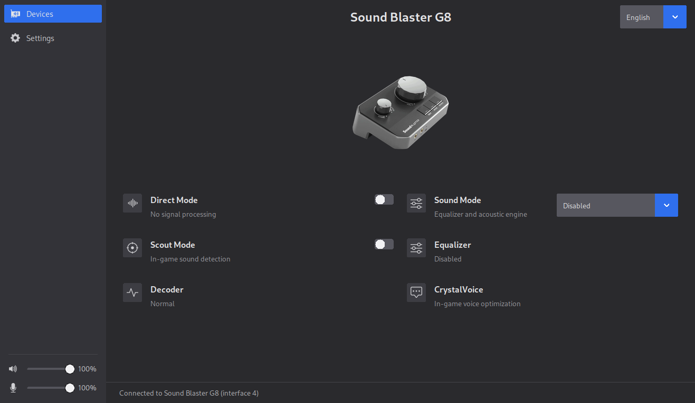

# Sound Blaster G8 Control

Open-source control application for the **Creative Sound Blaster G8** sound
card, on **macOS** and **Linux**. Creative does not provide native Linux App and provide outdated one for MacOS.
Reverse-engineered from the official Creative application: Scout Mode,
Direct Mode, sound mode presets, 10-band equalizer, CrystalVoice
(Noise Reduction, Voice Morph, Microphone Equalizer) and the Dolby Digital
decoder.



## Disclamer !!!

This application was created entirely by AI. It is provided as-is , WITHOUT WARRANTIES OR CONDITIONS OF ANY KIND, WITHOUT EVEN THE IMPLIED WARRANTY . Use it at your own risk. Most of the features from the Windows Creative App have been implemented.

## Installation

### .deb package (Debian/Ubuntu)

```bash
sudo apt install debhelper dh-python pybuild-plugin-pyproject \
    python3-all python3-setuptools gettext
dpkg-buildpackage -us -uc -b
sudo apt install ../soundblaster-g8_0.1.2-1_all.deb
```

Installs the app (`soundblaster-g8` on `$PATH`), a menu entry, and the
udev rule for unprivileged HID access. See
[docs/packaging.md](docs/packaging.md) for details.

### Manual (from source)

```bash
pip install -e .
python main.py          # or `soundblaster-g8` after installation
```

On Linux, the card's HID interface needs a udev rule for unprivileged
access, and there's a related ALSA quirk for the microphone — see
[docs/linux-setup.md](docs/linux-setup.md). macOS needs no special setup.

## Documentation

- [docs/protocol.md](docs/protocol.md) — feature status and the
  reverse-engineered USB protocol (framing, commands, per-feature detail)
- [docs/linux-setup.md](docs/linux-setup.md) — hidapi backends, udev
  access rights, ALSA microphone quirk
- [docs/packaging.md](docs/packaging.md) — building the `.deb` package
- [docs/contributing.md](docs/contributing.md) — capturing USB traffic and
  adding a feature, sound mode, or translation
- [docs/architecture.md](docs/architecture.md) — project structure and
  module responsibilities

## License

MIT
